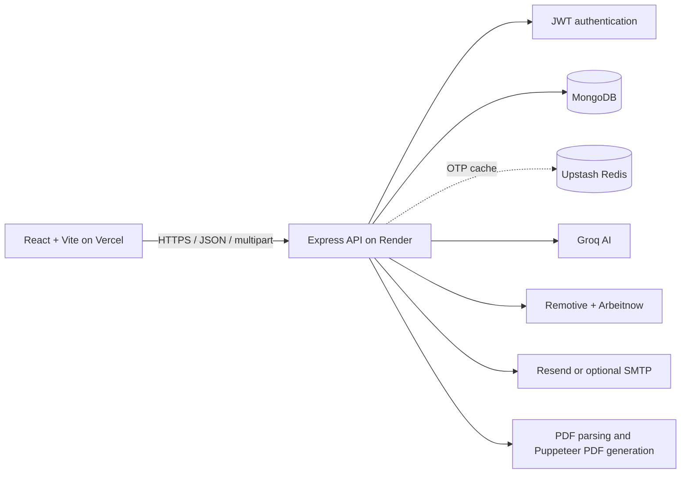

# PrepAI — AI Interview Preparation & Job Search

PrepAI is a full-stack career-preparation application. Users can create an account, verify their email, find market jobs, compare jobs with a resume, and generate a personalized interview-preparation plan from a job description and resume. Plans include a match score, technical and behavioral interview questions, skill gaps, and a day-by-day study roadmap. A tailored resume PDF can also be generated from a saved plan.

> **Important:** AI-generated suggestions and scores are estimates, not guarantees. Confirm job details, salary, application links, and recruiter contacts with the employer before acting on them.

## Contents

- [Features](#features)
- [End-to-end user flows](#end-to-end-user-flows)
- [Technology stack](#technology-stack)
- [Architecture](#architecture)
- [Repository structure](#repository-structure)
- [Requirements](#requirements)
- [Local setup](#local-setup)
- [Environment variables](#environment-variables)
- [Run, build, and lint](#run-build-and-lint)
- [Deployment](#deployment)
- [API reference](#api-reference)
- [Data model overview](#data-model-overview)
- [File upload and privacy notes](#file-upload-and-privacy-notes)
- [Known limitations](#known-limitations)
- [Troubleshooting](#troubleshooting)

## Features

### Accounts and authentication

- Registration with username, email, and password.
- Password hashing with bcrypt.
- Six-digit email verification codes (OTP); OTP hashes are stored in Redis when available and MongoDB is used as a fallback.
- Login, logout, current-user lookup, JWT authentication, and server-side session tracking.
- Protected interview-plan and Market Jobs pages.

### Interview plans

- Create a plan using a target job description and a resume PDF.
- Get a generated candidate/job match score, technical questions, behavioral questions, model-answer guidance, identified skill gaps, and a daily preparation roadmap.
- Reopen saved plans, view plan history, and delete plans.
- Download a job-tailored resume PDF from a saved plan.
- Start a plan from a Market Jobs listing; the job details and the currently selected resume are passed to Interview Plans.

### Market Jobs

- Search available listings and filter by experience level and work mode.
- Upload a resume PDF to request AI-assisted job matching and skill comparisons.
- Browse job summaries, inspect full details, and follow the listing's application link.
- Generate a draft cold-application email and send it using the configured email provider.
- Start an interview-preparation plan from a selected role.

Live listings are fetched from Remotive and Arbeitnow. If those sources do not return jobs, the service can fall back to AI-generated suggestions; those fallback suggestions are not verified live vacancies.

## End-to-end user flows

### Register and verify

1. The user registers with a username, email, and password.
2. The backend hashes the password, creates an unverified account, stores a time-limited OTP hash, and attempts to send an email.
3. The user submits the six-digit OTP. The backend verifies it, marks the account verified, creates a session, and returns a JWT.
4. The user can log in later and use protected application routes.

### Generate an interview plan

1. The user uploads a PDF resume and enters or selects a target job description.
2. The browser sends a multipart request to the Express API.
3. The backend extracts PDF text, sends the candidate and job context to Groq, and receives structured JSON for the plan.
4. The backend stores the extracted resume text, job description, user, score, questions, skill gaps, and roadmap in MongoDB.
5. The browser opens the saved plan page. The user can review its sections, download a tailored resume PDF, return to the dashboard, or delete a plan.

### Find jobs and prepare for a role

1. The user searches the Market Jobs page, optionally uploading a resume.
2. The backend fetches and normalizes listings from public job-board APIs, then uses Groq to score listings against an uploaded resume when available.
3. The user opens a listing's details or selects **Prep Strategy**.
4. The app navigates to Interview Plans with that job's description and selected resume in route state, ready for plan generation.

## Technology stack

| Area | Technologies |
| --- | --- |
| Frontend | React 19, Vite, React Router, Axios, Sass |
| Backend | Node.js, Express 5, CommonJS |
| Database | MongoDB Atlas or a local MongoDB server, via Mongoose |
| AI | Groq SDK and configurable Groq chat-completion models |
| Resume processing | `pdf-parse` for PDF text extraction; Puppeteer/Chromium for generated PDFs |
| Authentication | JWT, bcrypt, HTTP-only cookie, Authorization bearer token, MongoDB session/blacklist records |
| OTP cache | Upstash Redis REST, with MongoDB OTP fallback |
| Email | Resend HTTP API, with optional Gmail/Nodemailer fallback |
| Job listings | Remotive and Arbeitnow public APIs |
| Hosting | Vercel for the frontend and Render for the backend are supported deployment options |

## Architecture



The frontend uses React Context providers for authentication and interview reports. Axios services attach the stored bearer token and send credentialed requests. The API applies CORS using the configured frontend origin and local development origins. Protected API routes validate the JWT and associate stored reports with the authenticated user.

## Repository structure

```text
.
├── Backend/
│   ├── server.js                 # Load environment, connect database, start API
│   ├── Dockerfile                # Node 20 + Chromium deployment image
│   ├── src/
│   │   ├── app.js                # Express, CORS, middleware, API routers
│   │   ├── config/               # MongoDB and Upstash configuration
│   │   ├── controller/           # Authentication, interview, and jobs handlers
│   │   ├── middleware/           # JWT authentication and in-memory uploads
│   │   ├── models/               # User, OTP, report, session, token blacklist
│   │   ├── routes/               # REST API route definitions
│   │   ├── Services/             # AI, email, and public job-feed integrations
│   │   └── utils/                # OTP and email-template utilities
│   └── package.json
├── Frontend/
│   ├── src/
│   │   ├── features/auth/        # Register, verify, login, protected routes
│   │   ├── features/interview/   # Plan dashboard, report view, resume download
│   │   ├── features/jobs/        # Market Jobs search and job details
│   │   ├── app.routes.jsx        # Client-side routes
│   │   └── App.jsx               # Context providers and router
│   ├── vercel.json               # SPA route fallback
│   └── package.json
├── package.json                  # Root convenience scripts
└── README.md
```

## Requirements

- Node.js 20 or newer is recommended (the backend Docker image uses Node 20).
- npm.
- MongoDB Atlas or a local MongoDB instance.
- A Groq API key for AI features.
- Optional: Upstash Redis, Resend, and Gmail SMTP credentials.

## Local setup

1. Clone the repository and open its root directory.
2. Install dependencies for the root, backend, and frontend:

   ```bash
   npm run setup
   ```

3. Create `Backend/.env` using the template in [Environment variables](#environment-variables).
4. Optionally create `Frontend/.env` if your API is not at the local default. The variable name used by the frontend is `VITE_API_URL`.
5. Start frontend and backend together:

   ```bash
   npm run dev
   ```

6. Open the Vite URL printed in the terminal (usually `http://localhost:5173`). The backend defaults to `http://localhost:5000`.

You can run services separately from the root with `npm run dev:backend` and `npm run dev:frontend`.

## Environment variables

Never commit `.env` files, API keys, database credentials, JWT secrets, SMTP credentials, or real user data. The repository ignore rules exclude local environment files. Use separate secrets for local development and hosted environments.

### Backend — `Backend/.env`

```env
# Required for the database. If unavailable or connection fails, db.js attempts LOCAL_MONGO_URL.
MONGO_URL=mongodb+srv://<username>:<password>@<cluster>/<database>

# Strong, private signing secret for JWTs
JWT_SECRET=<long-random-secret>

# Groq AI integration
GROQ_GENAI_API_KEY=<groq-api-key>
# Optional preferred model; the service tries configured fallback models if needed
GROQ_MODEL=<groq-model-name>

# CORS: exact deployed frontend origin, without a trailing slash
FRONTEND_URL=https://<your-frontend>.vercel.app

# Optional local MongoDB fallback
LOCAL_MONGO_URL=mongodb://127.0.0.1:27017/PrepAI

# Optional Upstash Redis REST cache for OTPs (MongoDB is also used as fallback)
UPSTASH_REDIS_REST_URL=https://<your-database>.upstash.io
UPSTASH_REDIS_REST_TOKEN=<upstash-token>

# Optional email: Resend is tried first when configured
RESEND_API_KEY=<resend-api-key>
EMAIL_FROM=<verified-sender-address>

# Optional SMTP fallback: Gmail app password
EMAIL_USER=<sender-email>
EMAIL_PASS=<gmail-app-password>

# Alternatively, Gmail OAuth2 can be configured
GOOGLE_USER=<sender-email>
GOOGLE_REFRESH_TOKEN=<oauth-refresh-token>
GOOGLE_CLIENT_ID=<oauth-client-id>
GOOGLE_CLIENT_SECRET=<oauth-client-secret>
```

`MONGO_URL`, `JWT_SECRET`, and `GROQ_GENAI_API_KEY` are needed for the normal core application flows. Redis and email variables are optional integrations, but email verification delivery requires a working email provider; in development, the API may include a development OTP in its response. Never expose that development behavior in production.

`FRONTEND_URL` must match the deployed frontend origin exactly so credentialed CORS requests are accepted. In production, set `NODE_ENV=production` so authentication cookies use secure cross-site settings. Render generally sets this for production services.

### Frontend — `Frontend/.env`

```env
VITE_API_URL=http://localhost:5000
```

For a hosted build, set `VITE_API_URL` to the Render backend base URL, for example `https://<your-api>.onrender.com`. Vite embeds `VITE_` variables into the browser bundle at build time; these values are public and must never contain secrets.

## Run, build, and lint

Run from the repository root unless otherwise noted:

| Command | Purpose |
| --- | --- |
| `npm run setup` | Install root, backend, and frontend dependencies |
| `npm run dev` | Run frontend and backend concurrently |
| `npm run dev:backend` | Run the backend development script |
| `npm run dev:frontend` | Run Vite frontend development server |
| `npm run build` | Build the frontend for production |

Frontend-only scripts (run from `Frontend/`):

| Command | Purpose |
| --- | --- |
| `npm run build` | Create the production bundle in `Frontend/dist` |
| `npm run lint` | Run ESLint |
| `npm run preview` | Preview the Vite production bundle locally |

The backend package currently has no automated test suite configured; its `npm test` script is a placeholder that exits with an error.

## Deployment

### Vercel — frontend

1. Import the GitHub repository into Vercel.
2. Set **Root Directory** to `Frontend`.
3. Use `npm run build` as the build command and `dist` as the output directory (Vercel normally detects the Vite preset automatically).
4. Add the environment variable `VITE_API_URL` with the Render backend's public HTTPS URL.
5. Deploy. The checked-in `Frontend/vercel.json` rewrites client-side routes to `index.html` so paths such as `/jobs` and `/interview/<id>` load correctly.
6. Copy the deployed Vercel origin into the Render `FRONTEND_URL` setting.

### Render — backend

The backend includes a Dockerfile that installs Chromium for Puppeteer. A Render **Docker** web service is the recommended deployment path:

1. Create a new Web Service connected to the GitHub repository.
2. Set the root directory to `Backend` and select the Docker runtime. Ensure Render uses `Backend/Dockerfile`.
3. Configure the backend environment variables listed above in the Render dashboard. Use the MongoDB Atlas URL, JWT secret, Groq key, and exact Vercel origin. Add Redis and email credentials if those integrations are enabled.
4. Deploy and wait for the service to become healthy. The backend reads `process.env.PORT` and Render supplies that value.
5. Set the Vercel `VITE_API_URL` to the Render service URL and redeploy Vercel after changing it.

A native Node Render service can also use `Backend` as its root directory, `npm install` as the build command, and `npm start` as the start command. Because Puppeteer needs Chromium and its system libraries, the Dockerfile path is generally the more predictable option for PDF generation.

### After pushing changes to GitHub

If Render and Vercel are linked to the same branch, a push normally triggers their deployments automatically. Check each provider's deployment logs and confirm that frontend and backend environment variables are still set. If the frontend API URL changes, rebuild/redeploy Vercel because Vite inlines that variable during build.

## API reference

All job and interview endpoints and most account endpoints require authentication. The backend accepts the JWT from the `token` cookie or an `Authorization: Bearer <token>` header. The frontend sends the bearer token and enables credentialed requests.

### Authentication — `/api/auth`

| Method | Path | Purpose | Input |
| --- | --- | --- | --- |
| `POST` | `/register` | Create an unverified account and send an OTP | JSON: `username`, `email`, `password` |
| `POST` | `/verify-email` | Verify OTP and establish a session | JSON: `email`, `otp` |
| `POST` | `/login` | Authenticate a verified user | JSON: `email`, `password` |
| `GET` | `/logout` | Clear session and blacklist the token | Cookie or bearer token |
| `GET` | `/get-me` | Get current authenticated user | Authenticated request |

### Interview plans — `/api/interview`

| Method | Path | Purpose | Input |
| --- | --- | --- | --- |
| `POST` | `/` | Generate and store an interview plan | Multipart: `resume`, `jobDescription`, optional `selfDescription` |
| `GET` | `/` | List the current user's saved plan summaries | Authenticated request |
| `GET` | `/report/:interviewId` | Fetch one plan owned by the current user | Authenticated request |
| `DELETE` | `/:interviewId` | Delete a plan owned by the current user | Authenticated request |
| `POST` | `/resume/pdf/:interviewReportId` | Generate and download a tailored resume PDF | Authenticated request |

### Market Jobs — `/api/jobs`

| Method | Path | Purpose | Input |
| --- | --- | --- | --- |
| `POST` | `/match` | Fetch listings and score them against an uploaded resume | Multipart: optional `resume`, `query`, `experienceLevel`, `workMode` |
| `GET` | `/available` | Fetch general listings | Query parameters: `query`, `experienceLevel`, `workMode` |
| `POST` | `/generate-email` | Draft an AI-generated application email | JSON: `jobTitle`, `company`, `jobDescription`, optional `resumeText` |
| `POST` | `/send-email` | Send email through the configured provider | JSON: `recipientEmail`, `subject`, `emailContent` |

The email draft service currently uses the user's account name/email and job description; it does not automatically load the saved resume text when generating the draft.

## Data model overview

- **User:** username, email, bcrypt password hash, verified status, timestamps.
- **OTP:** user reference, email, SHA-256 OTP hash, creation/expiry timestamps. Redis is used when available; MongoDB records also provide fallback verification.
- **Session:** user reference, token, IP address, user agent, timestamps.
- **Token blacklist:** revoked tokens used by the authentication middleware to reject logged-out sessions.
- **Interview report:** owner, extracted resume text, self-description, job description, generated title, match score, technical and behavioral questions, skill gaps, preparation plan, timestamps.

Market-job results are fetched/normalized for requests and are not stored as a user's permanent job collection by these routes.

## File upload and privacy notes

- Upload middleware keeps files in memory and enforces a **3 MB** limit.
- Resume parsing currently uses `pdf-parse`; use PDF files for job matching and interview-plan generation.
- The frontend file picker also advertises DOCX, but the backend parsing path is PDF-specific. DOCX parsing is not implemented yet.
- Interview reports store the extracted resume text and job description in MongoDB so the user can revisit the plan and generate a tailored PDF later.
- Resume and job data are sent to the configured AI provider to generate scores and content. Do not upload sensitive information unless you understand and accept that processing.
- Use TLS/HTTPS in production and keep databases, API keys, and email credentials private.

## Known limitations

- AI-generated job data, match scores, model answers, predicted HR addresses, and email drafts may be inaccurate. Verify them independently. A successful email API response means it was dispatched, not that the recipient address is valid or the email was read.
- Job feeds depend on third-party services and can change availability, fields, or rate limits. AI-generated fallback listings should not be represented as confirmed vacancies.
- The backend upload limit is 3 MB, while some frontend copy says 5 MB; the backend limit is authoritative.
- The UI accepts a DOCX extension in places, but resume extraction is PDF-only today.
- The standard register flow requires email verification. Email sending depends on your provider configuration and its sender verification/sandbox policies.
- There is no automated backend test suite configured yet.

## Troubleshooting

| Symptom | Checks |
| --- | --- |
| Frontend reports a network/CORS error | Confirm `VITE_API_URL` points to the backend and Render `FRONTEND_URL` exactly matches the deployed Vercel origin. Redeploy Vercel after changing a Vite environment variable. |
| Backend fails during startup | Check Render logs and confirm MongoDB URL, Atlas network access, and `JWT_SECRET` are configured. |
| AI generation fails | Confirm `GROQ_GENAI_API_KEY` is valid and check backend logs for provider/model rate limits. `GROQ_MODEL` is optional. |
| OTP email does not arrive | Check Resend sender/domain verification and account restrictions, or configure Gmail SMTP fallback. In development, check the API response for a development OTP. |
| OTP verification fails | OTPs expire after five minutes; request a new registration flow and use the newest code. Confirm Redis and MongoDB connectivity. |
| PDF upload is rejected | Upload a valid PDF under 3 MB. DOCX extraction is not supported by the backend yet. |
| Tailored resume PDF fails on Render | Deploy with the provided Dockerfile so Chromium and its required libraries are installed; check Render logs. |
| `/jobs` or an interview URL returns a Vercel 404 | Confirm Vercel is rooted at `Frontend` and `Frontend/vercel.json` is deployed. |

## License

No root `LICENSE` file is currently included. Add a license file if you want to formally license reuse of this project.
